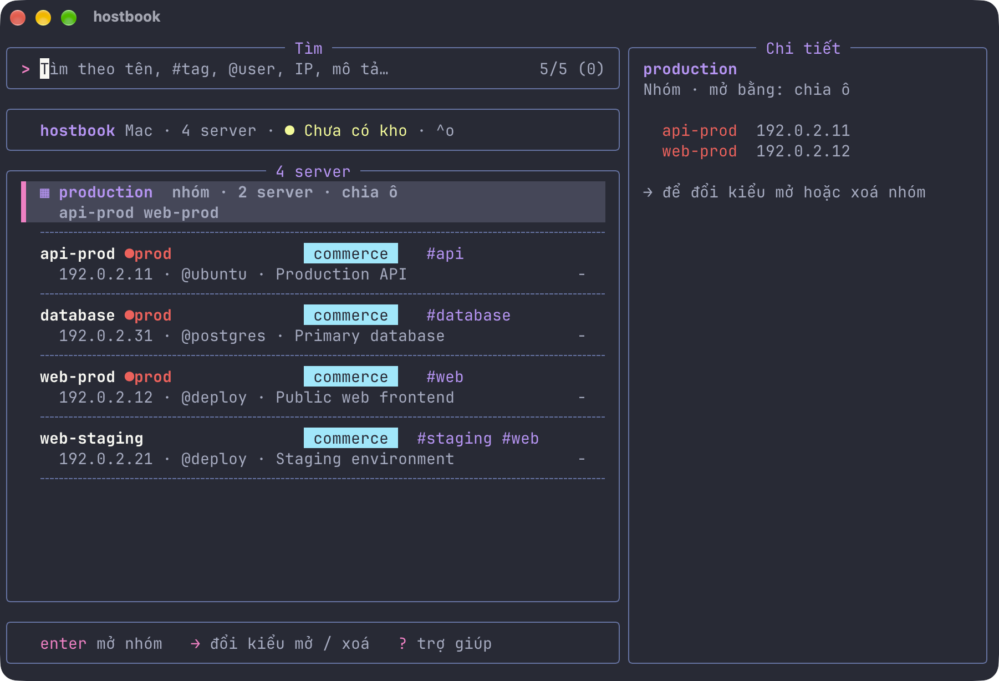

# hostbook

**Your SSH hosts, one search away.**

A terminal SSH host manager for macOS and Linux. Find a host, open a group in tmux,
and keep your SSH configuration in sync through a Git repository you control.



## Built for everyday SSH

- **Find and connect.** Search names, tags, users, addresses, and descriptions.
- **Work across servers.** Save groups and open tmux splits, tabs, or synchronized sessions.
- **Keep machines in sync.** Store standard SSH config in Git, with per-host conflict resolution.
- **Bring your credentials.** Manage reusable SSH keys and passwords in an age-encrypted vault.
- **Share a workspace.** Export selected hosts, with or without their credentials, as a password-encrypted package.
- **Make it yours.** Choose compact lists or two-line cards, color themes, English or Vietnamese, and your terminal's background.

No hostbook account or hosted service required. Your hosts remain standard SSH
configuration, usable with `ssh`, `scp`, and VS Code Remote-SSH.

## Get started

You need Git, curl, tar, and OpenSSH.

```bash
curl -fsSL https://raw.githubusercontent.com/duong6003/hostbook/main/install.sh | bash
```

Close and reopen your terminal, then start Hostbook.

```bash
hostbook
```

The installer sets up the app and dependencies under `~/.local` without admin access.
Setup adds the `hb` alias when available. Choose English or Vietnamese on first run
and change it later in **Tools → Appearance → Language**.

To install from a clone instead (for example to contribute), run
`git clone https://github.com/duong6003/hostbook.git ~/.local/share/hostbook` and then
`bash ~/.local/share/hostbook/install.sh`. Details and updates: [Getting started](https://github.com/duong6003/hostbook/wiki/Getting-started).

[Getting started](https://github.com/duong6003/hostbook/wiki/Getting-started)
 · [User guide](https://github.com/duong6003/hostbook/wiki)
 · [Appearance](https://github.com/duong6003/hostbook/wiki/Appearance)
 · [Security](https://github.com/duong6003/hostbook/wiki/Secrets-and-security)

## Contribute

See the [development guide](https://github.com/duong6003/hostbook/wiki/Development)
for architecture, local checks, and documentation updates.
[Report a bug](https://github.com/duong6003/hostbook/issues).

Released under the [MIT license](LICENSE).
